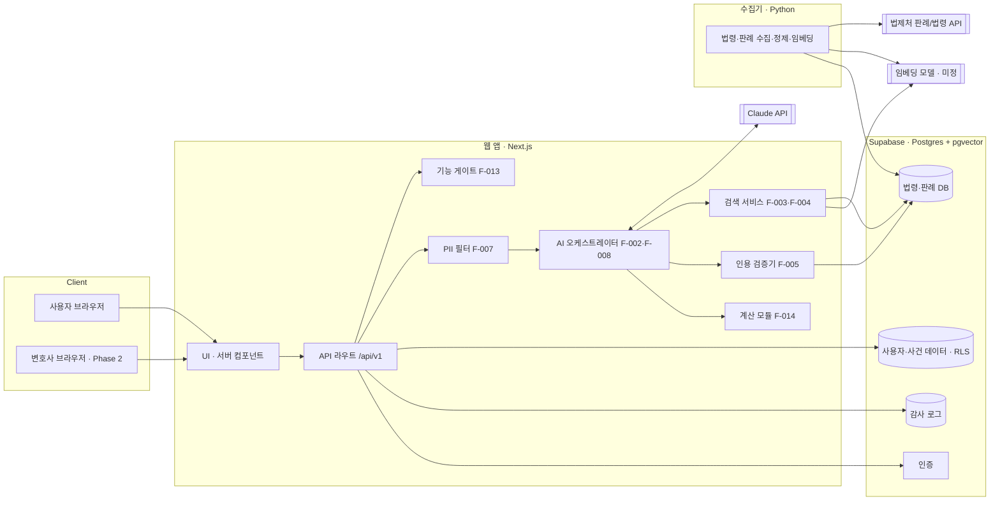
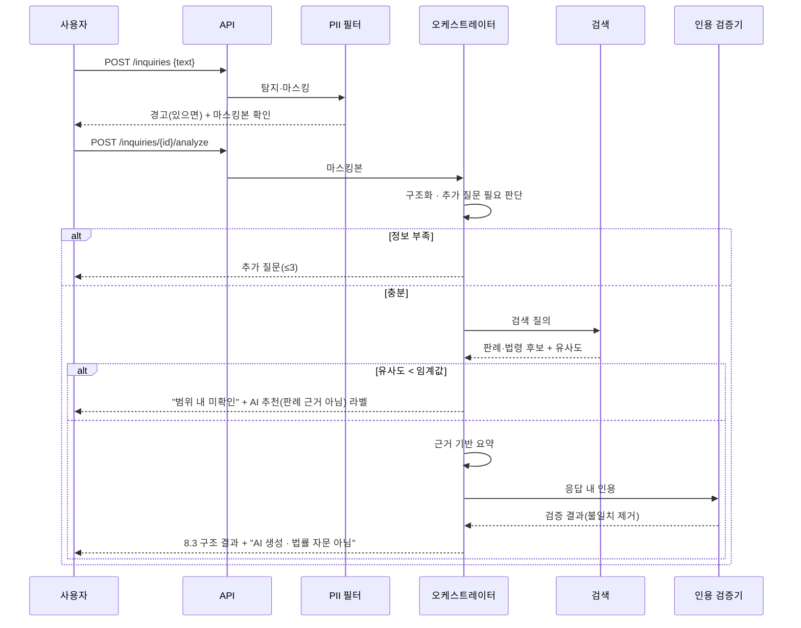
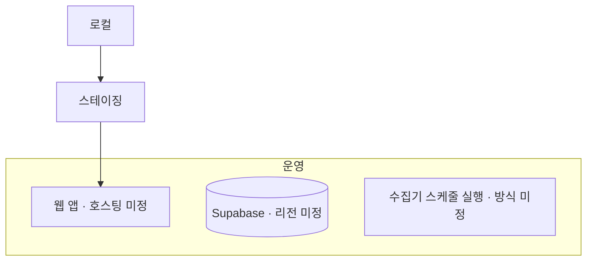

# 햄찌법원 기술 설계 (ARCHITECTURE)

> 기준: `docs/PRD.md` v1.1 · 버전 v0.2 (2026-10-19) · 데이터: `docs/DATA_MODEL.md` · API: `docs/API.md`
> 스택 확정(DEC-004): Next.js + Supabase(Postgres·pgvector·Auth) + Python 수집기
> 표기: **(제안)** = PRD에 없는 설계 판단, 하단 OPEN QUESTION에서 확정 필요 · `[게이트]` = F-013 승인 전 비활성

## 1. 설계 원칙 (PRD에서 도출)
| 원칙 | 근거 | 설계 반영 |
|---|---|---|
| 근거 없는 인용 금지 | N2, F-005 | LLM 응답을 그대로 내보내지 않고 **인용 검증기**를 거친 뒤 렌더링 |
| 숫자는 계산으로 | CLAUDE.md 규칙 3, F-014 | 기간·비용은 `calc` 모듈(순수 함수)만 생성 |
| PII 최소화 | F-007, 9.2 | 입력 직후 **PII 필터** → LLM에는 마스킹본만 전달 |
| 원본/공개본 분리 | 9.2, F-011 | 사건 원본·공개 개요·변호사 제공본을 별도 테이블·권한으로 분리 |
| 미승인 기능 차단 | F-013 | 모든 `[게이트]` 경로가 서버에서 **게이트 검사** 후 실행 |

## 2. 시스템 구성도

## 3. 컴포넌트 책임
| 컴포넌트 | 책임 | F-ID | 하지 않는 일 |
|---|---|---|---|
| UI | 검색창 1개 홈, 결과(8.3 구조), 요약 확인·수정, 동의 화면, 변호사 게시판 | 전체 | 서버 검증 없이 결과 표시 |
| API 라우트 | 인증·권한·입력 검증(빈 입력 차단 F-001 AC2)·**비로그인 1회 제한**(익명 세션 쿠키, F-001 AC3)·레이트 리밋, 에러 표준화 | F-001, 전체 | 비즈니스 로직을 UI에 노출 |
| 기능 게이트 | `feature_gates` 상태 조회, `Approved` 아니면 `FEATURE_GATED` 반환, 운영자 변경 감사 기록 | F-013 | 클라이언트 플래그만으로 판단 |
| PII 필터 | 이름·전화·주민번호·계좌·주소 패턴 탐지 → 경고·마스킹, 민감정보 동의 확인. 원문은 요청 메모리 안에서만 처리하고 버림 | F-007 | 원문을 DB·로그·프롬프트에 저장 (DEC-006) |
| AI 오케스트레이터 | 구조화(사실/추론/확인 필요), 추가 질문 ≤3, 검색 질의 생성, 근거 기반 요약, Phase 2 에이전트 대화·요약서 | F-002, F-006, F-008 | 숫자 생성, DB 밖 인용, 결과 단정 |
| 검색 서비스 | 하이브리드 검색(키워드 + 벡터) → 재정렬 → 유사도 임계값 판단 | F-003, F-004, F-006 | 판례 원문 외부 재수집 |
| 인용 검증기 | 응답 속 사건번호·조문을 DB와 대조 → 불일치 제거/“미확인” 표시, 실패율 기록 | F-005 | 검증 실패 항목 통과 |
| 계산 모듈 | 절차 단계·기간·비용(인지대 등) 계산, 출처 첨부 | F-014 | LLM 호출 |
| 수집기 | 공식 API 증분 수집, 파싱, 비식별 재검사, 청킹·임베딩, 버전·시행일 관리, 실패 기록 | 9.1, 9.3 | 판결서 인터넷 열람 수집 |
| 감사 로그 | 원본 접근, 동의, 게이트 변경, 변호사 열람 기록 | 9.2, F-012 | 사건 원문 저장 |

## 4. 핵심 흐름
### 4.1 Phase 1 분석 요청

### 4.2 Phase 2 상담 연결 `[게이트]`
F-014 "전문가 권장" → 에이전트 방향 조율(F-008) → 요약서 확인(F-009) → 공개 개요 생성·간접식별 점검(F-011) → 승인 변호사 열람(F-010) → 제안(F-012) → 사용자 선택 → 별도 동의 → 선택 변호사에게만 상세 제공 + 감사 기록.
각 단계 API는 게이트 검사를 먼저 수행한다.

## 5. 외부 연동
| 대상 | 용도 | 방식 | 실패 처리 | 상태 |
|---|---|---|---|---|
| 법제처 판례 본문 조회 API (공공데이터포털) | 판례 수집 | 배치 증분 | 재시도·실패 기록, 서비스는 기존 DB로 계속 | 확정(PRD 9.1) |
| 국가법령정보 공동활용 Open API | 법령·조문·시행일 | 배치 + 버전 관리 | 동일 | 확정(PRD 9.1), 상업 재게시 조건 확인 필요 |
| 대법원 판결서 인터넷 열람 | 원문 링크 | 링크만 | — | 수집 안 함 |
| Claude API | 구조화·요약·에이전트 | 서버 호출, 스트리밍 (제안) | `MODEL_FAILED` 구분 반환(F-006 AC2) | 후보(PRD 8.2) |
| 임베딩 모델 | 벡터 검색 | 수집 시·질의 시 | 키워드 검색만으로 폴백 (제안) | 미정 |
| 인증 | 소셜 로그인(Google 등)·역할·익명 세션 | Supabase Auth | 로그인 실패 시 비로그인 1회 범위로 유지 | 확정(DEC-004, DEC-005) |

LLM 호출 원칙: 마스킹본만 전송, 시스템 프롬프트·도구 정의를 고정해 프롬프트 캐싱, 응답·인용은 검증 후 저장.

## 6. 배포 구조

| 항목 | 내용 |
|---|---|
| 환경 | 로컬 / 스테이징 / 운영 (제안). 스테이징은 실제 사용자 데이터 없음 |
| 비밀 관리 | API 키는 서버 환경변수만, 클라이언트 노출 금지(PRD 13) |
| 마이그레이션 | DB 스키마는 마이그레이션 파일로 관리, 운영 반영은 사람 승인 |
| 관측 | 기능별 장애·지연·LLM 비용·인용 검증 실패율 지표 (PRD 13, 14) |
| 성능 목표 | 판례 검색 p95 ≤ 3초, AI 분석 p95 ≤ 15초 (PRD 13) |
| 백업 | RTO/RPO는 출시 전 정의 (PRD 13) |

## 7. 보안 요약
역할: `user` / `lawyer`(승인 후, Phase 2) / `admin`. 모든 사용자 데이터 테이블에 행 단위 보안(RLS) 적용. 원본 사건 데이터 접근은 감사 로그 필수. 상세 권한표는 `DATA_MODEL.md` 5절.

---
## OPEN QUESTION
| ID | 질문 | 영향 | 관련 PRD |
|---|---|---|---|
| ~~OQ-ARC-01~~ | ✅ 해결: 스택 확정 (DEC-004) | 전체 | 8.2 |
| OQ-ARC-02 | AI 오케스트레이터를 웹 앱(TypeScript) 안에 둘지, 별도 서비스(Python)로 분리할지 | 구성도, 배포 | 8.2 |
| OQ-ARC-03 | 임베딩 모델 선택과 차원 수 | 검색, DATA_MODEL | 8.2 |
| OQ-ARC-04 | 키워드 검색 엔진: Postgres 전문검색으로 충분한가, 한국어 형태소 분석 엔진이 필요한가 | 검색 품질(8.4 Top-5 ≥70%) | 8.4 |
| OQ-ARC-05 | 웹 호스팅·DB 리전(국내 보관 필요 여부)·수집기 실행 방식 | 배포 | 9.2(국외 이전) |
| OQ-ARC-06 | AI 응답을 스트리밍으로 보여줄지(로딩 체감 개선) | API, UI | 13 |
| OQ-ARC-07 | 유사도 임계값(F-006)과 재정렬 방식 | 검색 | F-006 |
| OQ-ARC-08 | LLM 제공업체로의 전송이 처리위탁/국외이전 중 무엇에 해당하며 어떤 고지가 필요한가 | 외부 연동 | 9.2 |
| OQ-ARC-09 | 관측 도구(에러·로그·제품 분석) 선택 | 배포 | 13, 14 |
