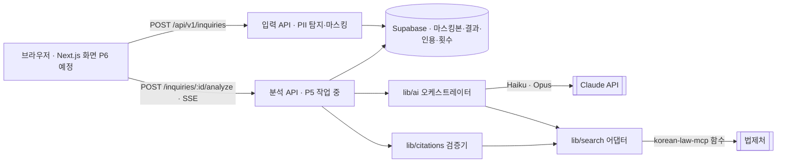
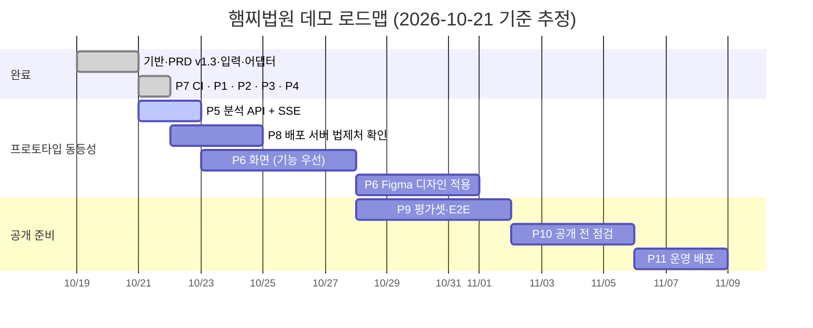

# 햄찌법원 × 참고 프로토타입 비교 분석 보고서

> 작성일: 2026-10-21 · 기준 커밋: `01000f9` (main) + 작업 중인 P5(커밋 전)
> 비교 대상: [Lee-Soyeon/legal-precedent-prototype](https://github.com/Lee-Soyeon/legal-precedent-prototype) (커밋 `e1ee138`, 2026-10-11) · 배포본 https://legal-precedent-prototype.vercel.app
> 분석 범위: 저장소 전체 코드(`api/ask.js` 234줄, `index.html` 374줄), 배포본 실제 호출 1건, 햄찌법원 파이프라인 실제 호출 1건(같은 질문)

---

## 0. 결론 (먼저, 솔직하게)

| 질문 | 답 |
|---|---|
| 개발 방향이 프로토타입과 같은가? | **예.** 2026-10-19에 PRD v1.3(DEC-009~013)으로 방향을 바꾼 뒤, 프로토타입의 10단계 파이프라인을 그대로 옮기고 있습니다. 같은 korean-law-mcp 4.15.6 함수를 쓰고, 결과 형식(의도 요약·문단별 출처+원문 구절·법령/판례/검증 탭·재검색 과정·이어 묻기)도 같습니다. |
| 답변 생성·출력이 되는가? | **서버 내부에서는 됩니다. 사용자가 쓸 수 있는 상태는 아직 아닙니다.** 같은 질문으로 직접 돌려 보니, 우리 파이프라인(P3 분석 + P4 검증)은 41초 만에 검증을 통과한 답변 문단 6개를 냈습니다. 그러나 이 결과를 밖으로 내보낼 분석 API(P5)는 지금 작성 중이고, 화면(P6)은 아직 없습니다. 배포 사이트(hamzzi-courthouse.vercel.app)는 "준비 중" 화면만 보여 줍니다. |
| 프로토타입과 같은 수준으로 쓰려면? | **P5(분석 API) → P6(화면) → P8 마무리(배포 서버에서 법제처 호출 확인)** 세 가지가 남았습니다. 이 셋이 끝나야 프로토타입처럼 "사이트에 질문 → 답변"이 됩니다. |
| 이 프로젝트를 계속할 의미가 있나? | 기능 방향은 프로토타입과 일치하고, 핵심인 답변 생성·검증은 실제로 동작함을 확인했습니다. 다만 **프로토타입은 오늘 바로 쓸 수 있고 우리는 아직 아닙니다.** 이 격차를 줄이는 것이 최우선입니다(7장 권고). |

한계: 비교는 질문 1건 기준입니다. 품질 우열을 말하려면 P9 평가셋(20건)이 필요합니다.

---

## 1. 실측 비교 (같은 질문)

질문: "전세 계약이 끝났는데 집주인이 새 세입자가 들어와야 보증금을 준다고 하면서 돌려주지 않아요. 어떻게 해야 하나요?"

- 프로토타입: 배포본의 `/api/ask`를 호출했습니다. 화면이 내부적으로 보내는 요청과 같습니다.
- 햄찌법원: `runDemoAnalysis` → `verifyDraft`를 실제 법제처·Claude API로 1회 실행했습니다. 저장소 밖 임시 테스트로 돌렸고, 저장소 코드는 바꾸지 않았습니다.

| 항목 | 프로토타입 | 햄찌법원 (P3+P4) |
|---|---|---|
| 응답 시간 | **85.3초** | **40.9초** (분석 40.3초 + 검증 0.5초) |
| 모델 | OpenAI `gpt-6-luna`(의도) · `gpt-6.1-sol`(재검색·답변) | Claude `claude-haiku-5-5`(의도) · `claude-opus-5-5`(재검색·답변) |
| 검색어 | 6개 (첫 검색 3 + 재검색 3) | 3개 |
| 조문 후보 / 답변에 쓴 조문 | 16 / 4 | 16 / 5 |
| 판례 후보 / 답변에 쓴 판례 | 17 / **0** | 8 / **1** (2024다326398) |
| 재검색 | 3라운드, 도구 호출 9회 | 1라운드, 도구 호출 3회 (55초 시간 예산 때문에 줄임) |
| 답변 문단 | 5 | 6 |
| 검증 통과 | 5/5 (출처 확인 + 원문 구절 일치 + 법제처 재조회 실존) | 6/6 (같은 3단계, 제거 0·구절 불일치 0) |
| 토큰·비용 | 공개되지 않음 | 입력 43,717 · 출력 3,448 토큰 (약 0.2~0.3달러, lib/ai README 측정치) |
| AI 고지 | LLM이 쓴 문장 ("법률 자문이 아닙니다") | 코드 고정 문구 `AI 생성 · 법률 자문 아님` + 검색 범위 안내 |

**답변 내용 비교**

| 다룬 내용 | 프로토타입 | 햄찌법원 |
|---|---|---|
| 보증금을 받을 때까지 임대차관계 존속 (주택임대차보호법 제4조) | ✓ | ✓ |
| 임차권등기명령 신청 (제3조의3) | ✓ (2문단) | ✓ |
| 보증금반환소송 후 경매, 반대의무 이행 불필요 (제3조의2) | ✓ | ✓ |
| 가압류 (민사집행법 제276조) | ✓ | — |
| 분쟁조정위원회 (제14조) | — | ✓ |
| 소액사건심판법 준용 (제13조) | — | ✓ |
| 판례: 점유를 잃으면 대항력 소멸 → 등기 확인 후 이사 (2024다326398) | — | ✓ |
| "새 세입자가 와야 준다"는 주장의 효력 | 다루지 않음 (민법 제536조 동시이행을 찾았지만 쓰지 않음) | 근거에 직접 다룬 자료가 없어 판단하지 않는다고 밝힘 |

두 결과 모두 지어낸 조문이나 사건번호가 없었습니다. 핵심 조치(임차권등기명령 → 소송 → 경매)도 같았습니다.

---

## 2. 프로토타입 분석

### 2.1 구조

```mermaid
flowchart LR
  B[브라우저 · index.html 한 장] -->|POST /api/ask {question, history}| F[Vercel 서버 함수 · api/ask.js]
  F -->|chat/completions · responses| O[[OpenAI]]
  F -->|lawSearch.do · lawService.do 직접 fetch| L[[법제처 DRF]]
  F -->|korean-law-mcp 함수 import| K[korean-law-mcp 4.15.6]
  K --> L
```

| 항목 | 내용 |
|---|---|
| 형태 | 정적 HTML 한 장 + 서버 함수 1개. 빌드 도구·프레임워크·DB·로그인 없음 |
| 의존성 | `korean-law-mcp` 하나 (OpenAI는 fetch로 직접 호출) |
| 상태 | 서버는 아무것도 저장하지 않음. 이어 묻기 맥락은 브라우저가 들고 있다가 매번 보냄 |
| 횟수 제한 | IP당 10분에 5회. 서버 함수 메모리에만 있어서 인스턴스가 바뀌면 초기화됨 |
| 응답 | 한 번에 JSON 전체. 기다리는 동안은 3초마다 바뀌는 재미있는 문구를 보여 줌 (실제 진행 단계와 무관) |

### 2.2 서버 로직 (`api/ask.js`, 멘티 설계 10단계)

| 단계 | 하는 일 | 구현 |
|---|---|---|
| 1 입력 | 질문 600자, 이전 대화 최근 3개(답변은 문단당 400자) | 핸들러 |
| 2 의도 분석 | 분야, 알고 싶은 것, 관련 법률 2개, 조문 키워드 4개, 판례 검색어 3개 (JSON 모드) | `openai(INTENT_MODEL)` |
| 3 법령 검색 | 법령명 → `lawSearch.do` → `lawService.do`로 전문을 받아, 키워드가 조문 제목에 있으면 3점·본문에 있으면 2점으로 점수를 매겨 상위 3개를 고름 | `findArticles` (법제처 DRF 직접 호출) |
| 4 판례 검색 | 판례명+본문 검색(`search:'both'`), 검색어당 6건, 중복 제거 후 8건 상세 조회. 판시사항이 비어 있으면 본문의 "이 유" 이후 1,400자를 씀 | `searchPrecedentsStructured`, `getPrecedentRecord` |
| 4-2 재검색 에이전트 | 지금까지 찾은 목록을 보여 주고 빠진 근거를 찾게 함. 도구 2개(`search_law_articles`, `search_precedents`), 최대 3라운드·라운드당 3회 | OpenAI responses API |
| 5 RAG | 조문·판례를 `[번호] (종류) 제목 + 원문`으로 묶음. 벡터 DB 없음 | 핸들러 |
| 6·8·9 답변 | 근거 안에서만 답하고, 문단마다 `source`(법령명 제N조 또는 사건번호)와 원문 그대로의 `quote`(20~60자)를 붙임 | `openai(ANSWER_MODEL)` |
| 7-1 검증 | `source`가 가져온 자료에 있는지, `quote`가 원문에 그대로 있는지 (공백·문장부호 제거 후 비교) | 핸들러 |
| 7-2 재조회 | 답변의 조문·사건번호를 법제처에서 다시 조회 | `verifyCitations` |
| 10 제공 | 의도·조문·검색어·판례·답변·검증·재조회·재검색 과정·모델명 | JSON |

**검증 결과의 처리 방식이 중요합니다.** 프로토타입은 검증에 실패한 문단도 **지우지 않고** "확인 필요" 표시만 붙여 보여 줍니다. 재조회에서 실존하지 않는다고 나와도 문단은 그대로 남습니다.

### 2.3 화면 기능 (`index.html`)

| 기능 | 내용 |
|---|---|
| 홈 | 배너, 질문창(600자), "질문하기" |
| 피드 | 분야 필터(전체·임대차·노동·형사·사기·가족) + 예시 질문 5개(세이프홈즈·로톡 실제 글을 줄인 것). 누르면 바로 질문 |
| 기다리는 화면 | 스피너 + 3초마다 바뀌는 문구 15개 + "30초~1분" 안내 |
| 결과 요약 | 분야 배지, 알고 싶은 것, 관련 법률, 숫자 4개(법령 조문·판례 후보·답변 근거·검증 통과) |
| 검색어 | 검색어와 검색 건수 알약 |
| 탭 | 답변(문단 카드: 출처, 검증 통과/확인 필요, 본문, 원문 구절) · 법령(답변에 사용/참고만) · 판례(법원·선고일·사건명) · 검증(인용 대조 결과 + 법제처 재조회 결과) |
| AI가 더 찾아본 것 | 라운드별 도구·검색어·새로 찾은 것 |
| 이어서 물어보기 | 앞 질문·답변 스레드를 쌓아 두고 다음 질문에 맥락으로 보냄 |
| 하단 메뉴 | 홈·법률상담·리뷰작성·마이페이지 (홈 외에는 동작하지 않는 장식) |

### 2.4 프로토타입의 한계 (서비스로 쓸 때)

- 원문을 그대로 OpenAI와 법제처 검색어로 보냅니다(개인정보 마스킹 없음).
- 결과와 기록이 남지 않고, 새로고침하면 사라집니다.
- 횟수 제한이 메모리 기준이라 우회하기 쉽습니다.
- AI 고지 문구를 LLM이 만듭니다.
- 피드가 다른 플랫폼 이용자의 글입니다.
- 응답이 85초로 깁니다(이번 측정).

프로토타입은 실습용이라 이 한계들은 당연합니다. 다만 그대로 서비스로 내놓으면 PRD 절대 규칙 4·6과 저작권 문제에 걸립니다.

---

## 3. 햄찌법원 현재 구조

### 3.1 구조



| 계층 | 위치 | 상태 |
|---|---|---|
| 입력·개인정보 | `app/api/v1/inquiries`, `lib/pii`, `lib/inquiries` | 완료 |
| 비로그인 3회·이어 묻기·남은 횟수 | `lib/inquiries`, `consume_anon_question` DB 함수, `GET /me/quota` | 완료 (배포 사이트에서도 quota 응답 확인) |
| 법제처 어댑터 | `lib/search/law-source.ts` (`LawSource` 인터페이스, `EvidenceSet`) | 완료 |
| 분석 오케스트레이터 | `lib/ai` (의도 → 1차 검색 → 재검색 → 답변 → 1차 거르기) | 완료 |
| 인용 검증기 | `lib/citations` (출처 → 원문 구절 → 재조회 → 결과 조립) | 완료 |
| 분석 API + 스트리밍 | `app/api/v1/inquiries/[id]/analyze`, `lib/api/sse.ts`, `lib/inquiries/analyze.ts` | **작업 중** (다른 세션, 커밋 전) |
| 화면 | `app/` | **없음** (리디자인 세션에서 Figma 기준 설계 중) |
| 배포 | Vercel(hamzzi-courthouse.vercel.app), 리전 서울 icn1, CI(GitHub Actions) | 연결됨. 배포 서버에서 법제처 호출 확인은 남음 |

### 3.2 분석 파이프라인 (프로토타입과 대응)

| 프로토타입 단계 | 햄찌법원 | 차이 |
|---|---|---|
| 1 입력 | `POST /inquiries` → PII 마스킹 → (필요하면) 마스킹 확인 → analyze | 원문은 저장하지 않고 마스킹본만 LLM에 보냄 |
| 2 의도 분석 | `intent.ts` Haiku, 구조화 출력(zod) | 의도 요약에 단정 표현·질문에 없는 숫자가 있으면 비움 |
| 3 법령 검색 | `searchArticles`(법제처 지능형 법령검색) + 의도가 지목한 조문 직접 조회 | 프로토타입은 법령 전문을 받아 키워드 점수로 고름 |
| 4 판례 검색 | `searchCases` + `getCase` (판례 상세 최대 4건) | 같은 korean-law-mcp 함수 |
| 4-2 재검색 | `agent.ts` Opus, 도구 3개(`search_law`·`get_article`·`search_precedent`), 최대 3라운드 | 시간 예산(55초)이 모자라면 라운드를 줄임 |
| 6·8·9 답변 | `answer.ts` Opus, 출처는 근거 키 목록(enum)에서만 고르게 함 | 근거 목록에 없는 출처를 구조적으로 쓸 수 없음 |
| (추가) 1차 거르기 | `screenPoints`: 근거에 없는 사건번호·조문, 단정 표현, 원문에 없는 숫자가 있는 문단 제거 | 프로토타입에는 없음 |
| 7-1 검증 | 출처 확인 + 원문 구절 대조 (NFKC·공백 무시) | 같음 |
| 7-2 재조회 | `verifyStatutes`·`verifyCases` | **실존이 확인되지 않은 문단은 제거** (프로토타입은 표시만) |
| 10 제공 | `DemoAnalysisResult` + DB 저장 + SSE 진행 단계 | 결과·인용·실패율 저장 |

---

## 4. 차이 정리

### 4.1 아키텍처

| 관점 | 프로토타입 | 햄찌법원 |
|---|---|---|
| 프레임워크 | 정적 HTML + Vercel 함수 1개 | Next.js 16 App Router + TypeScript |
| LLM | OpenAI (fetch 직접 호출) | Claude (Anthropic SDK, 프롬프트 캐시, 시간 초과·거절 처리) |
| 법제처 | DRF 직접 호출(법령) + korean-law-mcp(판례·재조회) | 모두 korean-law-mcp, 어댑터 한 곳에서만 호출 |
| 저장 | 없음 | Supabase: 마스킹 입력, 분석 결과, 인용, 익명 세션·횟수 |
| 사용자 | 없음 | 비로그인 3회 → Google 로그인(DEC-005·010) |
| 개인정보 | 처리 없음 | 탐지·마스킹, 민감정보 동의, 로그·프롬프트에서 원문 배제 |
| 응답 방식 | JSON 한 번 (85초 대기) | SSE로 단계별 진행 표시 (P5) |
| 횟수 제한 | 메모리, IP당 10분 5회 | DB, 세션 3회 + 같은 IP 24시간 10회 |
| 품질 장치 | 검증 2단계(표시만) | 1차 거르기 + 검증 3단계(실패 시 제거) + 고정 AI 고지 |
| 테스트·CI | 없음 | 단위 테스트, 실호출 테스트, DB 검증, GitHub Actions |
| 코드 규모 | 서버 234줄 | lib(ai·citations·search·inquiries·pii) 약 3,600줄 + API·DB |

### 4.2 기능 대응표 (프로토타입 기능 → 햄찌법원)

| 프로토타입 기능 | 햄찌법원 데이터/서버 | 햄찌법원 화면 |
|---|---|---|
| 질문 입력 | ✅ `POST /inquiries` | ❌ P6 |
| 예시 질문 피드 + 분야 필터 | — (직접 작성 예정, DEC-012) | ❌ P6 |
| 기다리는 화면 | ✅ 진행 단계 이벤트 5종 (P5에서 SSE로 전달) | ❌ P6 |
| 분야·알고 싶은 것·관련 법률 | ✅ `result.intent` | ❌ P6 |
| 검색어 + 건수 | ✅ `result.searches` | ❌ P6 |
| 답변 문단(출처·구절·검증 표시) | ✅ `result.answer.points[].check` | ❌ P6 |
| 법령 탭(사용/참고) | ✅ `result.articles[].used` | ❌ P6 |
| 판례 탭 | ✅ `result.cases[]` (`fromBody` 포함) | ❌ P6 |
| 검증 탭(대조 + 재조회) | ✅ `point.check` + `result.recheck` | ❌ P6 |
| AI가 더 찾아본 것 | ✅ `result.trace` | ❌ P6 |
| 이어서 물어보기 | ✅ `parentInquiryId` + 최근 3개 맥락 | ❌ P6 |
| 사이트에서 실제로 동작 | ⏳ P5 작업 중, 배포 서버의 법제처 호출은 미확인(P8) | ❌ |

**정리:** 프로토타입 기능의 데이터와 서버 로직은 거의 다 있습니다. 이를 사용자에게 보여 줄 통로(P5)와 화면(P6)이 비어 있습니다.

### 4.3 일부러 다르게 한 것과 그 이유

| 차이 | 이유 |
|---|---|
| 검증 실패 문단을 제거 | 절대 규칙 1: 검증 근거에 없는 판례·조문은 출력하지 않음 (F-005) |
| PII 마스킹, 원문 미저장 | 절대 규칙 4 (F-007, DEC-006) |
| 고정 AI 고지 | 절대 규칙 6 |
| 숫자·단정 표현 거르기 | 절대 규칙 2·3 |
| 피드를 직접 작성 | 다른 플랫폼 이용자 글의 저작권·약관 문제 (DEC-012) |
| Claude 사용 | 스택 결정 (DEC-004) |
| 60초 시간 예산 | 데모 응답 기준 p95 ≤ 60초 (DEC-013). 대신 재검색이 줄어듦 |

### 4.4 우리 방식의 위험

| 위험 | 내용 | 대응 |
|---|---|---|
| 답이 비는 경우가 늘 수 있음 | 실패 문단을 지우기 때문에, 근거가 약한 질문에서는 프로토타입보다 문단이 적게 나오거나 "결과 없음"이 될 수 있습니다. 이번 1건에서는 제거가 0건이었습니다 | P9 평가셋 20건으로 제거율을 측정 |
| 재검색 폭이 좁음 | 시간 예산 때문에 이번에는 1라운드만 돌았습니다(프로토타입은 3라운드). 판례 후보가 8건 대 17건이었습니다 | P9에서 시간 예산·라운드 수를 조정 |
| 비용 | Opus 기준 질문당 약 0.2~0.3달러 | P9에서 재검색 모델을 낮추는 안 비교 |
| 배포 서버에서 법제처 호출 | 우리 OC 키는 현재 개발 PC IP로만 확인했습니다. 프로토타입은 Vercel에서 법제처 호출이 되고 있으니 가능성은 높지만, 우리 키로는 아직 확인하지 않았습니다 | P8 마무리: 도메인 등록 후 배포 서버에서 진단 |
| 범위가 큼 | DB·로그인·게이트까지 있어 프로토타입보다 만들 것이 많습니다. 화면이 늦어진 이유입니다 | 7장: 화면을 기능 우선으로 먼저 |

---

## 5. 개발 과정 전체 (지금까지)

### 5.1 P 번호 이전: 기반 작업 (2026-10-19)

| 커밋 | 작업 | 세부 |
|---|---|---|
| `eb92164` | 초기 세팅 | 기획·설계 문서, Next.js·Supabase·수집기 저장소 구성 |
| `dae8c2f` `d7b8801` | 수집기 | 법제처 판례·현행법령 수집, 법령·판례 테이블, 중복 판례 처리 (DEC-009 이후 데모 검색 경로에서는 빠짐) |
| `1bd2cfb` | PRD v1.2 | 수집 결과 반영 (DEC-007 판례 전문 미저장, DEC-008) |
| `fe682bc` | 공통 기반 | 사용자·분석·운영 테이블, API 응답·로그 헬퍼(`withRoute`), Supabase 클라이언트 |
| `84e1f7f` | F-013 기능 게이트 | 게이트 규칙, 관리자 API, 변경 이력 DB 함수 |
| `e3acc44` | korean-law-mcp 개발용 연결 | Claude Code MCP |
| `78ae302` | **방향 전환: PRD v1.3** | 프로토타입 기준 데모로 재설계. DEC-009(korean-law-mcp 실시간 조회) · DEC-010(비로그인 3회) · DEC-011(프로토타입 결과 형식) · DEC-012(예시 질문 직접 작성) · DEC-013(60초·스트리밍) |
| `bb03f1b` | 입력 API | `POST /inquiries`, PII 탐지·마스킹, 민감정보 동의, pii-confirmation |
| `7c8dcf2` | 법제처 어댑터 | `LawSource`(조문·판례 검색·상세·재조회), 녹화한 응답으로 단위 테스트, `pnpm test:live` |

### 5.2 P1~P11

| P | 이름 | 세부 항목 | 상태 | 커밋 |
|---|---|---|---|---|
| **P7** | CI | GitHub Actions: lint·typecheck·test·docs:check, 수집기 pytest·ruff | ✅ 완료 | `7d4892f` |
| **P1** | 데모 DB + 비로그인 3회 + 이어 묻기 | `questions_used` 0~3, `parent_inquiry_id`, 인용 출처·구절 컬럼, `consume_anon_question`(세션 3회 + IP 해시 24시간 10회), `GET /me/quota` | ✅ 완료 | `0ef467b` |
| **P2** | DB 실제 적용 검증 | 개발용 Supabase(서울)에 마이그레이션 적용, `pnpm db:push`·`pnpm db:verify`(68/68) | ✅ 완료 | `8656133` |
| **P8** | 배포 기반 | Vercel GitHub 연결 배포, 환경변수, 함수 리전 icn1 | 🟡 일부 | `31435e0` |
| | | 남은 것: 법제처 도메인 등록 → 배포 서버에서 법제처 호출 진단 | ⏳ | — |
| **P3** | 분석 오케스트레이터 | 의도(Haiku) → 1차 검색 → 재검색(Opus, 최대 3라운드) → 답변(Opus, 출처 enum) → 1차 거르기, 시간 예산 55초, 진행 단계 콜백 | ✅ 완료 (실호출 약 41초) | `d80bb40` |
| **P4** | 인용 검증기 | 출처 → 원문 구절 → 법제처 재조회 → 결과·인용 행·실패율 | ✅ 완료 (검증 약 0.5초) | `01000f9` |
| **P5** | 분석 API + SSE | `POST /inquiries/{id}/analyze`, 소유권·PII 확인, P3→P4 실행, 결과·인용 저장, 성공 시 횟수 차감, SSE(step/result/error) | 🔵 **작업 중** | 커밋 전 |
| **P6** | 화면 | 홈·예시 질문·개인정보 확인·진행 표시·결과 탭·이어 묻기·로그인 안내·법제처 출처 표기 | ⬜ 미착수 (리디자인 세션에서 Figma 기준 설계 중, 브랜치 `claude/design-redesign-8d6713`) | — |
| **P9** | 데모 품질 확인 | 평가셋 20건, `pnpm eval`(인용 실존율·구절 일치율·금지 표현·p95), 배포 주소 대상 E2E | ⬜ | — |
| **P10** | 공개 전 점검 | legal-reviewer, 보안 검토, 개인정보처리방침·이용약관·출처 표기·국외 이전 고지 초안, 비용 상한·레이트 리밋 | ⬜ | — |
| **P11** | 운영 배포 | 운영 Supabase 분리, 도메인·롤백 문서, 관측(오류율·p95·비용·검증 실패율), 배포 후 점검 스크립트 | ⬜ | — |
| (병행) | 화면 리디자인 | 화면목록(IA), 사용자 흐름, 레이아웃, 핵심 화면, `docs/06_화면설계.md` | 🔵 설계 단계 (방향 결정 대기) | 브랜치 |

---

## 6. 이후 구현 예정과 로드맵

### 6.1 남은 작업

| 순서 | P | 할 일 | 끝나면 되는 것 | 사용자가 할 일 |
|---|---|---|---|---|
| 1 | P5 | 분석 API + SSE 마무리, 커밋 | API로 질문 → 검증된 답변 | — |
| 2 | P8 잔여 | 배포 서버에서 법제처 호출 진단 | 배포 사이트에서도 분석 가능 | 법제처에 도메인 등록 또는 문의 |
| 3 | P6 | 화면 (프로토타입 기능 전부 + Figma 디자인) | **사이트에서 프로토타입처럼 사용 가능** | Figma 시안 확정 |
| 4 | P9 | 평가셋·E2E | 품질 수치 확인 | 평가 질문 검토 |
| 5 | P10 | 공개 전 점검 | 외부 공개 가능 | 정책 문서 법률 검토 |
| 6 | P11 | 운영 배포 | 정식 데모 공개 | 운영 DB 승인 |
| 이후 | — | F-002 추가 질문·사실 수정, 수집 DB 재사용 검토, Phase 2 | — | 법률 검토(OQ-001~004) |

### 6.2 로드맵 (추정)



```
10/21 ─ P5 ──┐
10/22 ─ P8(법제처·도메인) ─┐
10/23 ─────── P6 기능 화면 ──────────┐  ← 이 시점에 "프로토타입과 같은 동작" 달성 목표 (10/28 전후)
10/28 ─────── P6 Figma 디자인 적용 ──┤ P9 평가 ──┐
11/02 ─────────────────────────────────────────── P10 ──┐
11/06 ──────────────────────────────────────────────────── P11 운영 배포 (11/09 전후)
```

날짜는 지금까지의 진행 속도를 기준으로 한 추정입니다. P8은 법제처 답변을 기다려야 해서 늦어질 수 있습니다.

---

## 7. 권고

1. **"프로토타입과 같은 동작"을 첫 목표로 못 박으세요.** P5가 끝나면 디자인 확정을 기다리지 말고, 프로토타입 화면 구성을 그대로 따른 기능 화면(P6 1차)을 먼저 만드세요. 그다음 Figma 디자인을 입히면 됩니다(P6 2차). 이렇게 하면 디자인 작업이 늦어져도 동작하는 사이트가 먼저 나옵니다.
2. **P8 법제처 확인을 P6와 같이 진행하세요.** 프로토타입은 Vercel에서 법제처를 부르고 있으니 우리도 될 가능성이 높습니다. 하지만 우리 키로 확인하기 전까지는 배포 사이트에서 분석이 실패할 수 있습니다.
3. **P9에서 프로토타입과 같은 질문 세트로 나란히 비교하세요.** 프로토타입 예시 질문 5개는 내부 평가용으로만 쓰고 화면에는 내보내지 마세요. 두 시스템의 문단 수, 검증 통과율, 응답 시간, 판례 사용 비율을 표로 남기면 멘토 피드백에 바로 답할 수 있습니다.
4. **우리 방식이 더 엄격하다는 점을 설명할 준비를 하세요.** 같은 기능에 개인정보 마스킹, 검증 실패 제거, 고정 고지, 기록 저장이 더해져 있습니다. 대신 답이 더 짧게 나올 수 있습니다.

---

## 8. 재현 방법

| 무엇 | 방법 |
|---|---|
| 프로토타입 호출 | 배포본에서 `fetch('/api/ask', {method:'POST', headers:{'Content-Type':'application/json'}, body: JSON.stringify({question, history: []})})` (화면이 보내는 요청과 같음, IP당 10분 5회 제한) |
| 햄찌법원 분석+검증 | `pnpm test:live` (`tests/live/pipeline.live.test.ts`, 같은 질문, 통계만 출력). 질문 1건에 과금됨 |
| 햄찌법원 배포 상태 | `GET https://hamzzi-courthouse.vercel.app/api/v1/me/quota` → 200 (`limit: 3`). 분석 API는 P5 배포 전이라 404 |
| 프로토타입 소스 | `git clone https://github.com/Lee-Soyeon/legal-precedent-prototype` (MIT 의존성 korean-law-mcp, 작성자 허락 하에 분석) |
