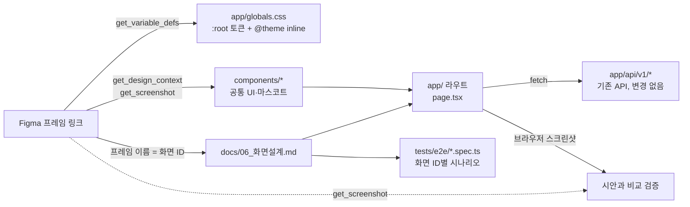

# 04. 화면설계 도구 조사 — Figma·Claude·AI 디자인 툴 비교와 작업 절차

> 조사일: 2026-10-21 · 목적: Vercel 배포(P8)와 화면 구현(P6) 전에 화면설계서·화면목록(IA)·User Flow·레이아웃·Key Screen을 새로 만들 도구와 절차를 정한다.
> 근거: 각 벤더 문서와 2026년 리뷰 글(맨 아래 출처). 가격·한도는 자주 바뀌므로 결제 전에 벤더 사이트에서 다시 확인한다. "확인 필요" 표시는 2차 자료만 찾은 항목이다.

---

## 0. 결론 먼저

| 질문 | 답 |
|---|---|
| Figma로 넘겨줘도 되나? | **된다.** Figma 원격 MCP로 Claude Code가 프레임·변수(토큰)·스크린샷을 직접 읽는다. 단, 파일을 아래 1.2 규칙대로 만들어야 번역 손실이 적다. |
| 가장 효율적인 조합 | **추천 A: Claude 중심** — IA·Flow는 `docs/06_화면설계.md`의 표와 Mermaid, 레이아웃·와이어프레임·시안은 기존 Claude 디자인 캔버스("AREO 디자인 시안"). 추가 비용 없음, 결과물이 실제 코드(HTML/CSS·토큰)와 같은 재료라 옮길 때 손실이 가장 적다. |
| Figma가 꼭 필요할 때 | **B: Figma 중심** — 외부 디자이너와 협업하거나 손으로 픽셀을 다듬고 싶을 때. Figma Professional Full 좌석(월 $16 연간·$20 월간)이면 Claude가 Figma에 직접 그리고(write to canvas), 사용자가 다듬고, Claude가 다시 읽어 구현한다. |
| 빼도 되는 것 | Relume(마케팅 사이트용 사이트맵), Uizard·Visily(비디자이너용 와이어프레임), Figma Make(프로토타입 코드가 우리 구조와 따로 놂). 이 프로젝트는 화면 수가 8개 안팎이고 토큰·폰트가 이미 코드에 있어 이점이 작다. |

---

## 1. Figma로 리소스를 넘길 때

### 1.1 넘기는 방법 (우선순위 순)

1. **Figma 파일 링크 + 프레임 링크** — 프레임을 우클릭 → "Copy link to selection"으로 얻은 `...?node-id=12-345` 링크를 화면 ID와 함께 준다. 원격 MCP는 선택이 아니라 링크로 읽는다.
   예: `S-01 홈 모바일: https://www.figma.com/design/<fileKey>/...?node-id=12-345`
2. **Figma 원격 MCP 연결** (한 번만) — Claude Code에 Figma 공식 플러그인을 설치하거나(공식 권장, MCP 설정과 Figma 스킬 포함) 직접 추가한다.
   ```bash
   claude mcp add --transport http figma https://mcp.figma.com/mcp
   ```
   처음 호출할 때 브라우저에서 Figma 로그인(OAuth). 개인 계정 인증이라 저장소 `.mcp.json`보다 사용자 범위 등록을 권한다.
3. **에셋** — 마스코트 등 일러스트는 SVG로 내보내 주거나, MCP `download_assets`로 Claude가 받는다.
4. **스크린샷·PDF만** — MCP를 못 쓸 때의 대안. 레이아웃·간격·토큰을 Claude가 추정해야 해서 정확도가 떨어진다.

Figma 요금 주의
- 원격 MCP 읽기 도구는 좌석·요금제별 호출 한도가 있다. 무료(Starter)·View/Collab 좌석은 매우 적은 횟수로 제한된다(확인 필요). 실작업은 유료 Dev($12) 또는 Full($16) 좌석을 전제로 한다.
- Claude가 Figma에 **그리기**(write to canvas)는 원격 서버 전용이고, 드래프트 밖에 쓰려면 Full 좌석이 필요하다.
- **Code Connect**(Figma 컴포넌트 ↔ 코드 컴포넌트 매핑)는 Organization·Enterprise 전용 → 이 프로젝트에선 쓰지 않고, 대신 1.3의 이름 규칙으로 맞춘다.
- **Variables REST API**는 Enterprise 전용. 하지만 MCP `get_variable_defs`는 일반 유료 좌석에서 쓰인다 → 토큰은 MCP로 읽는다.

### 1.2 Figma 파일을 만들 때 지킬 규칙 (개발이 편해지는 순서)

| 규칙 | 이유 |
|---|---|
| **페이지 구성**: `00 IA·Flow` / `01 Layout` / `02 Wireframe` / `03 Key Screen` / `04 Components` / `99 Archive` | Claude가 단계별로 찾기 쉽다 |
| **프레임 이름 = 화면 ID**: `S-01 홈 / mobile`, `S-01 홈 / desktop`, `S-04 결과 / tab=판례 / mobile`, `S-04 결과 / state=empty` | `docs/06_화면설계.md`·라우트·E2E 테스트와 1:1로 묶인다 |
| **상태는 프레임을 따로**: loading · empty · error · PII 확인 · LOGIN_REQUIRED | API 에러 코드(docs/API.md)와 상태를 하나씩 대조할 수 있다 |
| **Variables 이름 = 코드 토큰 이름**: `bg`, `ink`, `muted`, `gold`, `cream`, `honey`, `line`, `sage`, `fur`, `success-text`, radius `panel/card/button` | `app/globals.css`의 `--bg`·`--color-bg`로 그대로 옮긴다. 이름이 다르면 매번 대응표가 필요하다 |
| **Text Style 이름 = 용도**: `display/hero`, `display/section`, `display/card`, `body/base`, `body/input`, `caption` | 브랜드 가이드 3.2 타이포 표와 Tailwind 유틸리티로 바로 옮긴다 |
| **Auto Layout 사용**, 절대 위치 최소화 | MCP `get_design_context`가 flex·gap으로 정확히 읽는다 |
| **기준 폭**: mobile 375, tablet 768(선택), desktop 1280 (본문 최대 1120, 질문창 820) | 브랜드 가이드 3.3과 같게 |
| **컴포넌트 variant 이름 = 코드 props**: `HamzziJudge` → `size=hero|avatar|icon`, `mood=default|focus|happy|think|sorry|calm` | 브랜드 가이드 5절 props와 같게 |
| **고정 문구는 실제 문구로**: "AI 생성 · 법률 자문 아님"(=`AI_NOTICE`), 법제처 출처 표기 | 문구 위치만 디자인하고, 구현 시 상수로 바꾼다 (절대 규칙 6) |
| **동작은 Dev Mode 주석**으로: "SSE 단계마다 갱신", "3회 소진 시 S-06로" | 화면만으로 안 보이는 규칙을 남긴다 |
| **Pro·변호사 연결 화면은 그리지 않거나 `99 Archive`에** | F-013 게이트 전 (절대 규칙 5) |

### 1.3 받은 리소스를 이 프로젝트에 적용하는 경로



| 리소스 | 들어갈 곳 (현재 구조 기준) | 메모 |
|---|---|---|
| 색·반경 토큰 | `app/globals.css`의 `:root`(값) + `@theme inline`(Tailwind 이름) | Tailwind 4라 `tailwind.config.ts`가 없다. 브랜드 가이드 5절의 "tailwind.config.ts" 지시는 낡은 내용 → ⑤ 단계에서 고칠 후보 |
| 글꼴 | `app/layout.tsx`의 `next/font/google` 변수(`--font-plex-kr`·`--font-serif-kr`·`--font-playfair`) | 이미 연결됨. 굵기 추가만 필요할 수 있음 |
| 공통 컴포넌트 | 새 폴더 `components/` (예: `components/ui/`, `components/mascot/HamzziJudge.tsx`, `components/result/`) | 지금은 없다. 화면 구현(P6) 때 만든다 |
| 화면 | `app/page.tsx`(S-01), 결과·진행 화면 라우트(예: `app/inquiries/[id]/page.tsx`), 정책(`app/(legal)/privacy`, `terms`) | 라우트 경로는 ⑤ `docs/06`에서 확정 |
| 일러스트·아이콘 | 인라인 SVG 컴포넌트(색은 토큰) 또는 `public/` | 브랜드 가이드: 하드코딩 색 금지, 장식은 `aria-hidden` |
| 화면 명세 | `docs/06_화면설계.md` (화면 ID·F-ID·API·상태·필수 요소) | `pnpm docs:check`가 F-ID·API 경로를 검사하도록 확장 예정 |
| 흐름 | `docs/06`의 Mermaid + `tests/e2e/` 시나리오 | 예외 흐름(PII 409, 결과 없음, 검색·모델 오류, `LOGIN_REQUIRED`)마다 테스트 1개 |
| API·DB·lib | **변경 없음** | 화면은 기존 `app/api/v1` 응답만 쓴다 |

---

## 2. Claude로 할 수 있는 것

### 2.1 산출물별 방법

| 산출물 | Claude가 만드는 방법 | 결과물 위치 |
|---|---|---|
| 화면목록(IA) | PRD 12장·8.3, API.md 4절을 읽고 화면 ID 표 + Mermaid 트리 작성. 각 화면에 F-ID·API·에러 코드 연결 | `docs/06_화면설계.md` |
| User Flow | API의 상태 전이(POST /inquiries → 409 PII → pii-confirmation → analyze SSE → result / `LOGIN_REQUIRED`)를 그대로 Mermaid flowchart로. 정상·예외 흐름 분리 | `docs/06` (GitHub에서 그림으로 보임). 원하면 Figma `generate_diagram`으로 FigJam 보드 생성 |
| 레이아웃 구성 | 375·1280 아트보드에 헤더·본문 폭·그리드·AI 고지·출처 영역을 회색 박스로 | Claude 디자인 캔버스(Artifact "Design" 타입) |
| 와이어프레임 | 화면·상태별 회색조 아트보드, 실제 문구 사용 | 같은 캔버스, 페이지 분리 |
| Key Screen 시안 | `app/globals.css` 토큰·폰트를 그대로 써서 HTML/CSS로 그림 | 같은 캔버스 |
| 디자인 시스템 | 토큰·타이포·컴포넌트 미리보기 문서 | Artifact "Design System" 타입(선택) |
| 화면설계서 | 위 내용을 화면 ID 단위로 정리 | `docs/06_화면설계.md` (+ 공유용이면 Claude Docs) |
| Figma 쪽 작업(B안) | 원격 MCP `use_figma`로 프레임·Auto Layout·Variables 생성, `generate_figma_design`으로 실행 중인 화면을 Figma로 캡처 | 사용자 Figma 파일 |

참고: Anthropic의 **Claude Design**(claude.ai, Pro·Max·Team·Enterprise, 2026년 4월 프리뷰 → 8월 베타로 보도)은 코드베이스를 읽어 디자인 시스템을 만들고 "Send to Claude Code" 핸드오프 묶음(컴포넌트 구조·사용 토큰·레이아웃·에셋)을 넘긴다. 단 **Figma 내보내기는 없다**(PDF·PPTX·HTML·zip·Canva). 이 세션에서 쓰는 디자인 캔버스도 같은 계열이다.

### 2.2 내가 만드는 절차 (이번 리디자인에 적용할 순서)

1. **근거 수집** — PRD 해당 절, API.md 4·4.1절, 브랜드 가이드, `globals.css`만 읽는다.
2. **① IA·Flow** — `docs/06` 초안에 화면 표와 Mermaid 정상/예외 흐름. 사용자 확인.
3. **② 레이아웃** — 캔버스에 375·1280 공통 틀(헤더·본문 폭·고지·출처). 사용자 확인.
4. **③ 와이어프레임** — S-01~S-08 회색조, 상태별(로딩·빈·오류·PII·LOGIN_REQUIRED). 사용자 확인.
5. **④ 시안** — ③에 토큰·글꼴·마스코트 적용. 사용자 확인.
6. **⑤ 화면설계서** — `docs/06` 완성, CLAUDE.md 문서 지도 추가, `docs-check`에 F-ID·API 경로 검사 추가, `legal-reviewer`로 문구 검사, 커밋.
7. **구현(P6)** — 시안을 `components/`·`app/` 라우트로 옮기고, 브라우저로 띄워 시안과 스크린샷 비교, 화면 ID별 E2E 작성.

### 2.3 다른 툴 대비 이점과 한계

이점
- **프로젝트 문서를 근거로 그린다** — 화면마다 F-ID·API 경로·에러 코드가 붙고, 절대 규칙(AI_NOTICE, 확정 표현 금지, 3회 제한, 게이트 화면 제외)을 설계 단계에서 검사한다. 범용 AI 디자인 툴은 이 맥락이 없다.
- **같은 재료** — 시안이 HTML/CSS + 실제 토큰이라 구현 때 옮기는 손실이 작다. Figma→코드 변환 단계가 없다.
- **버전·검증** — 명세가 저장소(git)에 있고 `pnpm docs:check`로 문서 간 어긋남을 잡는다.
- **추가 비용·좌석 없음**, 한 대화에서 설계 → 구현 → 테스트까지 이어진다.

한계
- 손으로 픽셀을 미세 조정하는 편집기는 아니다(수정은 말로 요청).
- 외부 디자이너와 실시간 공동 편집·주석 문화는 Figma가 낫다.
- 마스코트 최종 일러스트 품질은 전문 일러스트레이터/전용 툴이 낫다(브랜드 가이드 6절 외주 여부와 연결).

### 2.4 도구 비교

| 도구 | 잘하는 것 | 이 프로젝트에서 약점 | 코드 연결 | 비용(2026, 확인 필요) |
|---|---|---|---|---|
| **Claude 디자인 캔버스 / Claude Design** | 문서 근거 설계, HTML 시안, 코드 핸드오프 | 손 편집 약함, Figma 내보내기 없음 | 직접(같은 HTML/CSS) | 유료 Claude 요금제에 포함 |
| **Figma Design + 원격 MCP** | 정밀 편집, 협업, 업계 표준 | 좌석 비용, 파일 규칙 지켜야 함 | MCP로 읽기·쓰기 | Full $16·Dev $12/월(연간) |
| **Figma Make** | 프롬프트 → 동작하는 프로토타입(React+Tailwind) | 별도 코드베이스, 크레딧 소모 큼, 결과 평범 | GitHub 내보내기·MCP 리소스 | AI 크레딧 |
| **FigJam** | IA·Flow 화이트보드 | — | MCP `get_figjam`·`generate_diagram` | Figma 좌석에 포함 |
| **Google Stitch** | 무료, 여러 화면 빠른 탐색, Figma 내보내기 | 실험 단계, 디자인 시스템 반영 불안정 | Stitch MCP(Google Cloud OAuth) | 무료(Labs) |
| **Relume** | 사이트맵 → 와이어프레임 | 마케팅 사이트용, 앱 흐름 약함 | Figma·Webflow 내보내기 | $18~38/월 |
| **Visily / Uizard** | 비디자이너 와이어프레임, 스크린샷→디자인 | 우리 토큰·규칙 모름 | Figma 플러그인, React 코드 | $11~14/월 |
| **v0 (Vercel)** | 프롬프트 → shadcn/Next 컴포넌트 | 설계 문서가 아니라 코드, 별도 스타일 | v0 MCP·Platform API | 크레딧제 |
| **Miro / Whimsical** | 보드·플로·마인드맵 | 화면 시안은 약함 | 각 공식 MCP | 요금제별 |
| **Penpot** | 오픈소스 Figma 대안, 공식 MCP | 생태계 작음 | 공식 MCP(셀프호스트 가능) | 무료/셀프호스트 |

---

## 3. 추천 도구와 처음부터 끝까지의 실제 과정

### 3.1 선택 기준과 판단
- 사용자 1인 + Claude Code 중심 개발, 화면 8개 안팎, 토큰·폰트가 이미 코드에 있음, 법적 문구 규칙이 많음.
- 그래서 "디자인 툴에서 예쁘게 → 코드로 번역"보다 "규칙을 아는 곳에서 설계 → 같은 재료로 구현"이 빠르고 안전하다.

**추천 A (Claude 중심, 기본값)**

| 단계 | 도구 | 산출물 |
|---|---|---|
| IA·User Flow | `docs/06_화면설계.md` 표 + Mermaid | 화면 ID 표, 정상·예외 흐름도 |
| 레이아웃·와이어프레임·Key Screen | Claude 디자인 캔버스("AREO 디자인 시안"에 페이지 추가) | 375/1280 아트보드, 상태별 화면 |
| 화면설계서 | `docs/06` | 화면별 목적·F-ID·API·상태·필수 요소·컴포넌트 |
| 검증 | `pnpm docs:check`, `legal-reviewer` | 문서 일치, 절대 규칙 |

**B (Figma 중심, 협업·손 편집이 필요할 때)**

| 단계 | 도구 | 산출물 |
|---|---|---|
| IA·Flow | `docs/06` Mermaid → `generate_diagram`으로 FigJam | FigJam 보드 |
| 레이아웃·와이어프레임 | Claude가 `use_figma`로 초안 프레임 생성 → 사용자가 Figma에서 수정 | Figma 페이지 01·02 |
| Key Screen | 사용자 편집 + Claude가 Variables 생성 | Figma 페이지 03 |
| 구현 | Claude가 MCP로 읽어 `components/`·`app/`에 반영, 구현 화면을 `generate_figma_design`으로 다시 Figma에 캡처해 비교 | 코드 + 비교 프레임 |

### 3.2 실제 과정 (A안 기준, B안 차이는 괄호)
1. **방향 확정** — 시각 방향(D+ 유지/새로), 기준 폭(모바일/데스크톱), 작업 위치(캔버스/Figma).
2. **IA** — 화면 ID 표 초안(S-01 홈 … S-08 정책), 각 화면에 F-ID·API 연결. 범위 밖 화면(관리자 게이트, Phase 2, Pro·변호사 연결) 명시.
3. **User Flow** — 정상: 홈 → (PII 409면) 개인정보 확인 → 분석 진행(SSE) → 결과 탭 → 이어 묻기. 예외: PII 확인 필요 / 결과 없음 / 검색·모델 오류 / 3회 초과 `LOGIN_REQUIRED`. (B: FigJam 보드로도 생성)
4. **레이아웃** — 공통 틀: 헤더(로고·남은 질문 수), 본문 폭(모바일 16px 여백, 데스크톱 1120), 질문창 820, AI 고지·법제처 출처 고정 영역, 그리드(모바일 4열·데스크톱 12열 제안).
5. **와이어프레임** — 핵심 5화면(홈, 개인정보 확인, 분석 진행, 결과 탭, 로그인 안내) × 상태.
6. **Key Screen 시안** — 토큰·글꼴·마스코트 적용, 모바일·데스크톱 각각. (B: 사용자가 Figma에서 다듬음)
7. **화면설계서** — `docs/06` 완성, `docs-check` 확장, 문서 지도 갱신, 문구 검사, 커밋.
8. **구현 연결(P6)** — 컴포넌트 → 화면 → API 연결 → 브라우저 스크린샷으로 시안 비교 → E2E.

### 3.3 이후 개발에서 AI로 도움받을 수 있는 범위

| 영역 | Claude가 하는 일 | 사람이 할 일 |
|---|---|---|
| 토큰·컴포넌트 | 시안/Figma 변수 → `globals.css`, 공통 컴포넌트·마스코트 SVG 컴포넌트 작성 | 최종 일러스트 확정 |
| 화면 구현 | `app/` 라우트, SSE 진행 표시, 탭, 상태 화면, 이어 묻기 | 체감 품질 확인 |
| 시각 검증 | 개발 서버를 브라우저 창에 띄워 375·1280 스크린샷 → 시안과 비교·수정 | 최종 승인 |
| 접근성 | 대비 4.5:1, 44px 터치 영역, `prefers-reduced-motion`, aria 점검 | — |
| 테스트 | 화면 ID별 E2E(Playwright), 예외 흐름 테스트 | — |
| 규칙 검사 | `legal-reviewer`로 AI_NOTICE·확정 표현·게이트 화면 노출 검사 | 법무 검토(P10) |
| 문서 동기화 | 화면이 바뀌면 `docs/06`·`docs-check` 갱신 | — |
| 배포 확인 | Vercel 프리뷰 URL에서 같은 스크린샷 검증 (Vercel MCP 연결 시 배포·로그 조회) | Vercel 계정 연결 |

---

## 4. 쓸 수 있는 API·MCP 전체 정리

### 4.1 Figma

| 종류 | 이름 / 주소 | 하는 일 | 조건 |
|---|---|---|---|
| MCP (원격, 권장) | `https://mcp.figma.com/mcp` 또는 Claude Code용 Figma 플러그인 | 아래 도구 전부 | 유료 좌석 권장, 쓰기는 Full 좌석 |
| MCP (데스크톱) | Figma 데스크톱 앱 로컬 서버 | 읽기 도구만(선택 기반) | Dev·Full 좌석, 조직·엔터프라이즈용으로 축소 |
| 읽기 도구 | `get_design_context`, `get_metadata`, `get_screenshot`, `get_variable_defs`, `get_figjam`, `get_motion_context`, `search_design_system`, `get_libraries`, `download_assets`, `whoami` | 레이아웃·코드(React+Tailwind 기본)·토큰·스크린샷·FigJam·에셋 읽기 | 일부 원격 전용 |
| 쓰기 도구 | `use_figma`, `create_new_file`, `generate_diagram`, `generate_figma_design`, `html_to_figma`, `send_code_to_figma`, `upload_assets`, `generate_image` | 프레임·변수·컴포넌트 생성, Mermaid → FigJam, 실행 중 화면·HTML → Figma 레이어, 로컬 프로젝트 → Make | 원격 전용, `generate_figma_design`은 일부 클라이언트(Claude Code 포함), `generate_image`는 AI 크레딧 |
| Code Connect | `get_code_connect_map`, `add_code_connect_map`, `get_code_connect_suggestions` 등 + Code Connect CLI | Figma 컴포넌트 ↔ 코드 컴포넌트 연결 | Organization·Enterprise 전용 → 이 프로젝트 제외 |
| MCP 프롬프트 | `create_design_system_rules` | 디자인→코드 규칙 파일 생성 | — |
| Figma Specs | `figma-spec` 스킬 | 팀 스펙 읽기·쓰기 | 오픈 베타 |
| REST API | `api.figma.com/v1/files/:key`, `/images`, `/comments`, `/dev_resources`, webhooks | 파일 구조·이미지 내보내기·주석·웹훅 | 개인 토큰/OAuth |
| REST Variables | `GET /v1/files/:key/variables/local` | 변수 일괄 조회 | **Enterprise 전용** → MCP로 대체 |
| Plugin API | `use_figma`가 내부적으로 실행 | 캔버스 조작 | — |
| Weave 도구 | `weave_*` | 이미지·영상 생성 | 별도 유료 계정 → 제외 |

### 4.2 Claude (이 환경에서 바로 사용 가능)

| 이름 | 하는 일 |
|---|---|
| Artifact "Design" 타입 | 라이브 아트보드 캔버스(레이아웃·와이어프레임·시안). 기존 "AREO 디자인 시안"이 이것 |
| Artifact "Design System" 타입 | 토큰·타이포·컴포넌트 미리보기 레퍼런스 |
| Artifact "Docs" / Claude Docs 커넥터 | 공유·코멘트용 화면설계서(.docx·PDF·Markdown 내보내기) |
| Claude Design (claude.ai) | 코드베이스 기반 디자인 시스템, "Send to Claude Code" 핸드오프 |
| 내장 브라우저(`preview_start`·스크린샷) | 개발 서버를 띄워 시안과 비교 |
| Playwright (프로젝트에 설치됨) | E2E·스크린샷 |
| `legal-reviewer` 에이전트 | 화면 문구 절대 규칙 검사 |

### 4.3 그 밖의 도구

| 도구 | API·MCP | 연결 | 메모 |
|---|---|---|---|
| Google Stitch | Stitch MCP | Google Cloud OAuth | 설정 번거로움, 공식 문서 확인 필요 |
| Penpot | 공식 MCP (Penpot 저장소 `mcp/`) | 원격: 자기 Penpot 도메인 + MCP 키 / 로컬: `http://localhost:4401/mcp` | 오픈소스 Figma 대안 |
| Miro | 공식 MCP `https://mcp.miro.com/` | OAuth, 엔터프라이즈는 관리자 허용 필요 | 베타 |
| Whimsical | 원격 MCP | OAuth | 마인드맵·와이어 개요·플로 생성 |
| shadcn | shadcn MCP | `pnpm dlx shadcn@latest mcp init --client claude` | 컴포넌트 레지스트리 검색·설치(쓸 경우) |
| Storybook | `@storybook/addon-mcp` | `npx storybook add @storybook/addon-mcp` → `localhost:6006/mcp` | 컴포넌트 매니페스트·상호작용·접근성 테스트, React 전용 프리뷰 |
| Vercel | 공식 MCP `https://mcp.vercel.com` | OAuth | 배포·로그 조회(P8과 연결) |
| v0 | v0 MCP · Platform API | API 키 | 컴포넌트 초안 생성(선택) |
| Relume · Visily · Uizard | 공개 MCP·API 찾지 못함 | Figma 플러그인으로 내보내기 | Figma 경유로만 연결 |
| Mermaid | MCP 불필요 | Markdown 코드 블록 | GitHub에서 그림으로 렌더, FigJam `generate_diagram` 입력으로도 사용 |

### 4.4 이 프로젝트 기준 최소 구성
- **A안**: 추가 연결 없음 (Claude 캔버스 + `docs/06` + 내장 브라우저 + Playwright).
- **B안**: + Figma 원격 MCP (사용자 범위 등록), Figma Professional Full 좌석 1개.
- 공통 선택: + Vercel MCP (P8 배포 확인용).

---

## 출처
- Figma MCP 서버 소개: https://developers.figma.com/docs/figma-mcp-server/
- Figma MCP 도구 목록: https://developers.figma.com/docs/figma-mcp-server/tools-and-prompts
- Claude Code와 Figma MCP 설정: https://help.figma.com/hc/en-us/articles/39888612464151-Claude-Code-and-Figma-Set-up-the-MCP-server
- Figma Code Connect 이용 조건: https://help.figma.com/hc/en-us/articles/23920389749655-Code-Connect
- Figma Variables REST API: https://developers.figma.com/docs/rest-api/variables-endpoints
- Figma 요금(2차 자료): https://www.banani.co/blog/figma-pricing-and-credits , https://uxmagic.ai/blog/figma-pricing
- Figma AI·Make 리뷰(경쟁사 작성): https://www.banani.co/blog/figma-ai-features-review
- Claude Design 출시: https://thenewstack.io/anthropic-claude-design-launch/
- Claude Design 핸드오프: https://claudefa.st/blog/guide/mechanics/claude-design-handoff
- Claude Design 요금: https://www.eesel.ai/blog/claude-design-pricing
- Google Stitch MCP(2차 자료): https://pasqualepillitteri.it/en/news/647/google-stitch-mcp-export-claude-code-design-to-code , https://aireiter.com/blog/google-stitch-review
- AI 와이어프레임 도구 비교: https://www.forasoft.com/blog/article/ai-wireframe-tools-comparison , https://www.unite.ai/best-ai-ux-ui-design-tools/
- Relume 내보내기 한계: https://community.relume.io/exporting-a-site-from-the-relume-site-builder-to-figma-MB0ld8CvcVyh
- Visily Figma·코드 내보내기: https://support.visily.ai/portal/en/kb/articles/how-to-export-designs-from-visily-to-figma , https://support.visily.ai/portal/en/kb/articles/how-to-export-designs-to-code
- Penpot MCP: https://help.penpot.app/mcp/
- Miro MCP: https://developers.miro.com/docs/mcp-intro
- Whimsical MCP: https://whimsical.com/learn/integrations/remote-mcp
- shadcn MCP: https://ui.shadcn.com/docs/mcp
- Storybook MCP: https://storybook.js.org/docs/ai/mcp/overview
- Vercel MCP: https://vercel.com/docs/ai-tooling/vercel-mcp
